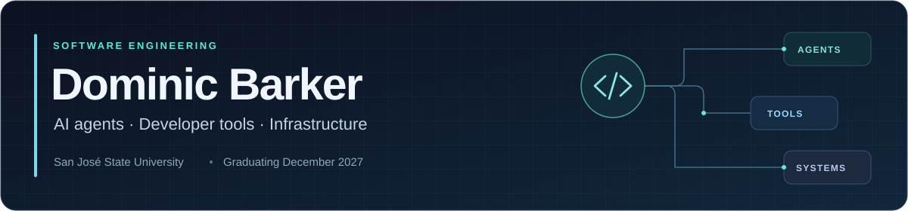

  

I'm studying software engineering at San Jose State University. I'm interested in how AI agents use tools and how the infrastructure around them supports useful work.

  <a href="https://www.linkedin.com/in/dominic-barker-94790a23b/">LinkedIn ↗</a> &nbsp;·&nbsp;
  <a href="https://www.youtube.com/watch?v=ovP3hvB6aew">CyberHacks demo ↗</a>

### Tools I work with

  
  
  
  
  
  

### Selected work

<table>
  <tr>
    <td width="50%" valign="top">
      01 / AI &amp; DEVELOPER TOOLS
      <h3><a href="https://github.com/DomBarker99/agent-harness">TypeScript agent harness</a></h3>
      
An experimental agent loop with an Ink terminal interface, OpenRouter integration and tool execution.

      TypeScript · Ink · OpenRouter
    </td>
    <td width="50%" valign="top">
      02 / INFRASTRUCTURE
      <h3><a href="https://github.com/DomBarker99/debian-gnome-novnc">Linux developer desktop</a></h3>
      
A Debian desktop with SSH, browser access, persistent home storage and automated image verification.

      Debian · Docker · noVNC · GitHub Actions
    </td>
  </tr>
  <tr>
    <td width="50%" valign="top">
      03 / SECURITY &amp; SYSTEMS
      <h3><a href="https://github.com/DomBarker99/x86-arc-and-code-injection-demo">CyberHacks x86 demonstration</a></h3>
      
A first-place SJSU team demonstration of memory exploitation and stack-canary defenses, with a video and technical report.

      x86 Assembly · GDB · Team project
    </td>
    <td width="50%" valign="top">
      04 / TEACHING &amp; JAVA
      <h3><a href="https://github.com/DomBarker99/java-dsa-practice">Java DSA tutoring set</a></h3>
      
Data-structures practice projects I use when tutoring Java. In the first, students implement one plane-seating interface twice, with a 2D array and with a doubly linked list. Each project comes with starter code, specifications, reference solutions and JUnit tests.

      Java · Data structures · JUnit · Tutoring
    </td>
  </tr>
</table>

### Currently

I'm developing my Talos Linux and Kubernetes lab and looking for software engineering and infrastructure internships.
